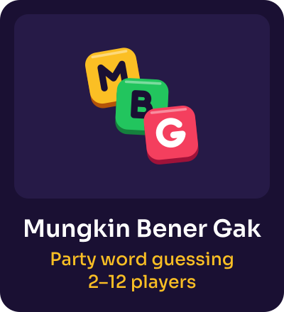
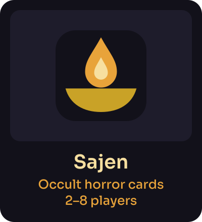
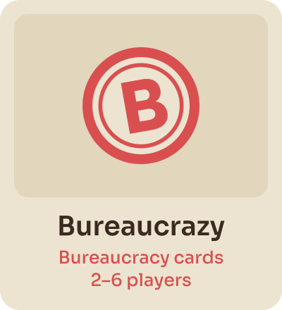
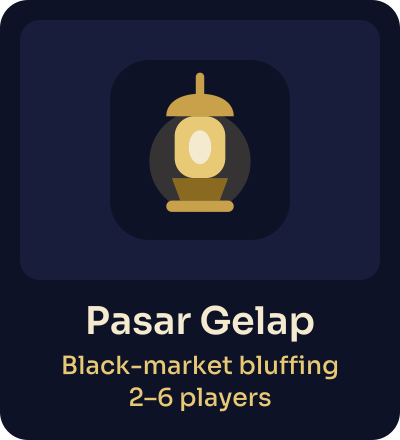

<picture>
  <source media="(prefers-color-scheme: dark)" srcset="./assets/zenet-banner-dark.svg">
  
</picture>

Board and card games for friends, played together in the browser. Open a game, share the
four-letter room code, and play. Nothing to install, and no account needed.

## Games

  
  
  
  

| Game | What it is | Players | Play |
|---|---|---|---|
| **Mungkin Bener Gak** | Everyone sees your word but you. Ask, get Maybe / Yes / No, guess it | 2–12 | [mbg.zenet.workers.dev](https://mbg.zenet.workers.dev) |
| **Sajen** | Prepare the offerings, summon what can't be seen. Indonesian occult horror cards | 2–8 | [sajen.zenet.workers.dev](https://sajen.zenet.workers.dev) |
| **Bureaucrazy** | Indonesian bureaucracy as a card game. Mohon bersabar, ini prosedur | 2–6 | [bureaucrazy.zenet.workers.dev](https://bureaucrazy.zenet.workers.dev) |
| **Pasar Gelap** | Black-market bluffing | 2–6 | [pasar-gelap.zenet.workers.dev](https://pasar-gelap.zenet.workers.dev) |
